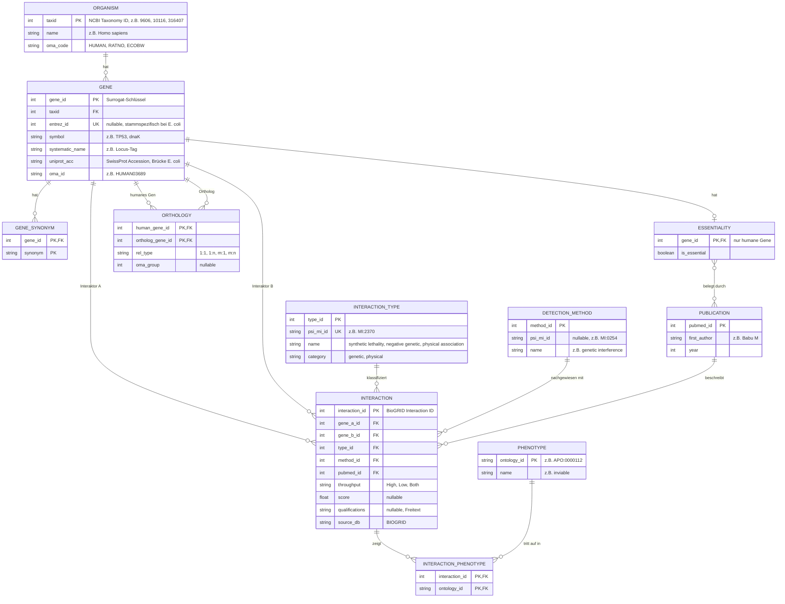

# ERD – Synthetic Lethality Datenbank

Ziel: Zu einem mutierten humanen Gen X alle synthetisch letalen Partner finden, nach Evidenz und Essentialität bewerten und prüfen, ob die Beziehung über Orthologe auch in *Rattus norvegicus* bzw. *E. coli K-12* vorkommt.

## Designentscheidungen

- **Ein Gen, mehrere IDs.** Entrez, SwissProt, Symbol und OMA-ID hängen am Gen. Das ist nötig, weil E. coli nur über SwissProt bzw. Symbol mit OMA verknüpft werden kann. Die Entrez-IDs von W3110 (`129xxxxx`) kommen in OMA nicht vor.
- **Eine Tabelle `INTERACTION` für alle Interaktionsarten.** Humane SL-Paare (MI:2370), negative genetische Interaktionen von E. coli (MI:2373, SL-Ersatz) und physische Interaktionen der Ratte unterscheiden sich nur über `INTERACTION_TYPE`.
- **Eine Zeile pro Interaktion und Publikation**, so wie in BioGRID. Wie stark ein Paar belegt ist, ergibt sich aus der Anzahl der Zeilen mit demselben Genpaar.
- **Paare normalisiert speichern.** Beim Import gilt `gene_a_id < gene_b_id`, damit (A,B) und (B,A) nicht doppelt zählen. In der SL-Datei gibt es 36 solcher Duplikate.
- **Mehrwertige Felder aufgelöst.** Synonyme und Phänotypen (in den Quellen `|`-getrennt) liegen in eigenen Tabellen. `Throughput` wird auf `High`, `Low` oder `Both` abgebildet.
- **`ORTHOLOGY` ist gerichtet**, von Mensch zu Ratte oder E. coli, weil die OMA-Dateien immer HUMAN-zu-X-Paare liefern.
- **`ESSENTIALITY` ist optional (1:0..1)**, weil Daten nur für humane Gene vorliegen.
- **Platzhalter-Score.** `score = -20.0000002` (25.670-mal in W3110) wird beim Import als `NULL` behandelt.

## Datei → Tabelle

| Quelldatei | Tabellen |
|---|---|
| `BIOGRID-SYSTEM-Synthetic_Lethality-5.0.263.tab3.txt` | GENE, GENE_SYNONYM, INTERACTION, PUBLICATION, PHENOTYPE, INTERACTION_PHENOTYPE |
| `BIOGRID-ORGANISM-Escherichia_coli_K12_W3110-4.4.225.mitab.txt` | GENE, INTERACTION, PUBLICATION, DETECTION_METHOD |
| `BIOGRID-ORGANISM-Rattus_norvegicus-4.4.225.mitab.txt` | GENE, INTERACTION, PUBLICATION, DETECTION_METHOD |
| `G-HumanEssential.tsv` | ESSENTIALITY, ESSENTIALITY–PUBLICATION |
| `OMA-Pairs_HUMAN-RATNO_*.csv` | GENE (oma_id, uniprot_acc), ORTHOLOGY |
| `OMA-Pairs_HUMAN-ECOBW_*.csv` | GENE (oma_id, uniprot_acc), ORTHOLOGY |

## Kernabfrage (Gen X)

1. In `GENE` das humane Gen X über Symbol oder Entrez-ID suchen.
2. In `INTERACTION` alle Einträge mit Typ *synthetic lethality*, an denen X beteiligt ist → Partner Y.
3. Für jedes Y:
   - `ESSENTIALITY` prüfen. Ist Y essentiell, ist es ein schlechtes Target.
   - Evidenz zählen: Anzahl Publikationen, Throughput.
   - Über `ORTHOLOGY` die Orthologe X' und Y' bestimmen und nachsehen, ob es zwischen ihnen eine Interaktion in Ratte oder E. coli gibt (Erhaltung über die Arten).
